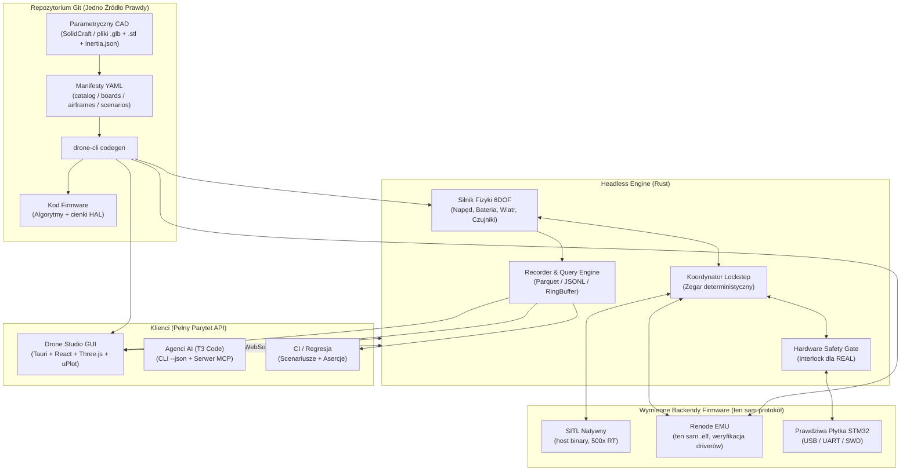
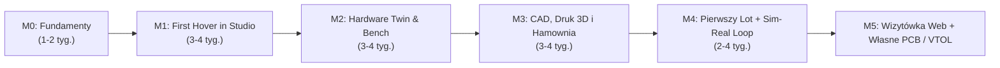

# Analiza strategiczna i architektoniczna: Własna platforma deweloperska do budowy dronów („Drone Studio”)

> [!NOTE]
> **Charakter dokumentu:** Analiza strategiczna, produktowa i architektoniczna na bazie [drone-devenv-brief.md](./drone-devenv-brief.md). Nie zakłada jeszcze wdrożenia — przedstawia ocenę wykonalności, wizję UX, warianty architektury, model danych, plan MVP oraz listę decyzji do zatwierdzenia.

---

## 1. Synteza Twojej wizji — czym ten projekt naprawdę jest?

Na podstawie briefu i Twojego doprecyzowania nie budujesz ani „kolejnego symulatora”, ani „kolejnego kontrolera lotu”. Budujesz **pionowo zintegrowane studio inżynieryjne dla dronów definiowanych programowo (_Software-Defined Drone Studio_)**, które ma spełnić **dwie role w czasie**:

1. **Dziś (narzędzie wewnętrzne, AI-first):** „fabryka oprogramowania” dla własnych dronów — miejsce, w którym człowiek projektuje architekturę, podgląda zachowanie drona wizualnie i testuje sprzęt, a **agenci AI piszą firmware, uruchamiają setki deterministycznych lotów, diagnozują awarie i stroją regulatory**.
2. **Jutro (produktowa wizytówka):** aplikacja na poziomie dopracowania _Linear / Figma / Teenage Engineering_ w świecie robotyki, w której każdy (inwestor, partner, przyszły klient) może kliknąć Waszego drona w 3D, zajrzeć pod maskę w trybie X-Ray, przetestować go w wichurze lub przy awarii silnika, a po podpięciu prawdziwego drona po USB zobaczyć, jak ta sama aplikacja ożywa prawdziwą telemetrią.

> [!TIP]
> **Kluczowy wniosek produktowy:** Cel „wewnętrzne narzędzie AI-first” i cel „olśniewająca wizytówka” **nie stoją ze sobą w sprzeczności**, o ile od dnia 1 rozdzielisz system na:
>
> - **Headless Engine (rdzeń fizyki, telemetrii, CLI i MCP)** — szybki, deterministyczny, obsługiwany przez agentów i CI,
> - **Studio Client (UI 3D + inspektor sprzętu + odtwarzacz lotów)** — cienki, piękny klient tego samego silnika, który z czasem może też działać jako interaktywne demo w przeglądarce.

---

## 2. Szczera ocena wykonalności: co i w jakim stopniu da się dowieźć?

Projekt jest **ambitny, ale bardzo realistyczny**, pod warunkiem bezwzględnego rozróżnienia tego, co warto napisać samemu (bo daje przewagę i prostotę), od tego, gdzie własna implementacja zjadłaby miesiące bez proporcjonalnego zysku.

| Obszar                                                                                                               | Wykonalność                         | Ocena inżynierska                                                                                                                                                                                                                                                                                                                                                                                                                         |
| -------------------------------------------------------------------------------------------------------------------- | ----------------------------------- | ----------------------------------------------------------------------------------------------------------------------------------------------------------------------------------------------------------------------------------------------------------------------------------------------------------------------------------------------------------------------------------------------------------------------------------------- |
| **Rdzeń 6DOF dla wielowirnikowca** (dynamika, napęd, bateria, wiatr/Dryden, modele czujników z szumem i biasem)      | **Bardzo wysoka (100%)**            | Dla quadcoptera matematyka jest dobrze znana i zamyka się w kilku tysiącach linii czystego kodu. Własny rdzeń wygrywa z Gazebo prostotą, determinizmem, szybkością (100×–1000× real-time) i działaniem natywnie na macOS.                                                                                                                                                                                                                 |
| **SITL z lockstepem + workflow pod agentów AI** (CLI, MCP, testy regresji, analiza logów)                            | **Bardzo wysoka (100%)**            | To będzie Wasza największa przewaga. Agenci AI potrafią pisać firmware, puszczać 50 scenariuszy w kilka sekund i iterować w pętli zamkniętej.                                                                                                                                                                                                                                                                                             |
| **Klient graficzny klasy „wizytówka”** (3D Digital Twin, X-Ray, live wykresy, Time Machine, inspektor płytki)        | **Wysoka (95%)**                    | Przy wyborze stacku webowo-desktopowego (**Tauri + React + Three.js/R3F**) da się uzyskać rewelacyjny UX i wizualną jakość nieosiągalną szybko w natywnych toolkitach (egui/Qt). Dodatkowo agenci AI są wybitni w tworzeniu UI w React/TS/Three.js.                                                                                                                                                                                       |
| **Własny firmware od zera na STM32** (estymacja orientacji, kaskada PID, mikser, failsafe, DShot, SPI DMA, blackbox) | **Wysoka (90%)**                    | Dla stabilizacji i lotu podstawowego quadcoptera — całkowicie wykonalne od zera. Klucz to czysta granica HAL, dzięki której 85–90% kodu testujesz w SITL zanim dotkniesz krzemu.                                                                                                                                                                                                                                                          |
| **Jedno źródło prawdy + pipeline CAD → symulator**                                                                   | **Wysoka (85–90%)**                 | Deklaratywne pliki YAML (BOM, płytka, rama) + generatory kodu to sprawdzony wzorzec. Z parametrycznym CAD sterowanym przez agenta (np. SolidCraft przez MCP) eksport STL + GLB + masa/bezwładność jest bardzo realny.                                                                                                                                                                                                                     |
| **Bliskość sim ↔ real dla drukowanego drona**                                                                        | **Średnio-wysoka (80%)**            | Z samych datasheetów uzyskasz ~15–25% rozjazdu. Z prostą hamownią (ciąg/prąd) i identyfikacją systemu z pierwszych logów realnych — zejdziesz do **<5% błędu w dynamice lotu**. **Uwaga:** nie symuluj MES-em elastyczności drukowanej ramy; zmierz widmo wibracji (FFT/PSD) na realnej ramie i wstrzyknij je jako model zakłóceń IMU.                                                                                                    |
| **Pełna emulacja MCU w Renode (wszystkie peryferia + własne czujniki)**                                              | **Średnia (60%) — pułapka czasowa** | Renode jest świetne do testu startu systemu, sterowników SPI/I2C/UART i logiki RTOS, ale: (1) nie jest cyklicznie dokładne, (2) zaawansowane tryby DMA/DShot timerów STM32 często wymagają dopisywania modeli w C#, (3) jest wolne w lockstepie, (4) na macOS Apple Silicon najwygodniej działa w kontenerze Linux. **Rekomendacja:** używaj Renode jako _warstwy weryfikacji sterowników_, nie jako głównego narzędzia codziennej pracy. |
| **Płatowiec / VTOL + fotorealistyczna wizja (kamera/SLAM)**                                                          | **Niska na start (faza 2/3)**       | Wymagają danych aerodynamicznych (XFLR5/AVL/OpenVSP lub plugin JSBSim) oraz zewnętrznego renderera GPU (Unreal/Isaac Sim — wymaga NVIDIA, brak wsparcia na macOS). Zaprojektuj architekturę tak, by kiedyś wpiąć te moduły jako pluginy, ale **nie buduj ich w MVP**.                                                                                                                                                                     |

---

## 3. Jak zbudować „turbo UX” — wizja produktu, który staje się wizytówką

Dlaczego istniejące narzędzia (Betaflight Configurator, Mission Planner, QGroundControl, Gazebo) nie budzą zachwytu? Bo wyglądają jak zbiór formularzy technicznych oderwanych od fizycznego obiektu, a symulacja żyje w zupełnie innym świecie niż podpięty dron.

Poniżej 6 filarów UX, które zamienią Wasze narzędzie w **produkt, który chce się pokazywać na ekranie**:

### 1. Jedno okno, jeden Cyfrowy Bliźniak — płynny przełącznik `SIM / EMU / REAL`

W górnym pasku aplikacji jest jeden przełącznik źródła prawdy:

- **`SIM (SITL)`** — chłodny akcent cyjanowy, pełna kontrola czasu (pauza, 0.1× slow-mo, 10× fast-forward, reset lotu jednym klawiszem `R`).
- **`EMU (Renode)`** — akcent bursztynowy, podgląd emulowanego MCU, rejestrów i magistral.
- **`REAL (USB / STM32)`** — akcent szmaragdowy (w stanie bezpiecznym) lub pulsująca czerwień (gdy uzbrojony), z czytelną barierą bezpieczeństwa.

**Ten sam układ ekranu, te same wykresy, ten sam model 3D drona.** Przełączenie z symulacji na prawdziwą płytkę leżącą na biurku (przechylasz płytkę w dłoni — dron 3D na ekranie obraca się z zerowym opóźnieniem) robi natychmiastowy efekt „wow”.

### 2. Interaktywny 3D Viewport jako serce aplikacji (tryb _Studio_ i tryb _X-Ray_)

Zamiast surowego widoku szachownicy z Gazebo:

- **Tryb Studio:** model 3D wyeksportowany prosto z Waszego CAD (`.glb`), estetyczne oświetlenie studyjne, czysta siatka przestrzeni z subtelną skalą metryczną i wskaźnikiem wiatru.
- **Tryb X-Ray (inżynierski):** rama staje się półprzezroczysta, a w środku podświetlają się kluczowe moduły (FC, ESC, bateria, IMU). Na dronie na żywo renderują się:
  - **wektory ciągu 3D** nad każdym śmigłem (wysokość = ciąg w niutonach, kolor = obciążenie/nasycenie),
  - **marker środka masy (CoM)** względem środka ciągu,
  - **„Ghost Target”** — półprzezroczysta sylwetka zadanej orientacji/pozycji nałożona na rzeczywistego drona (przeregulowanie PID widzisz gołym okiem w ułamku sekundy),
  - **wskaźniki termiczno-prądowe** (kolor baterii reaguje na voltage sag pod obciążeniem).

### 3. „Click-to-Inspect” Hardware Inspector (klikasz część — widzisz jej żywy stan)

Kliknięcie dowolnego komponentu na modelu 3D albo w widoku schematu płytki otwiera prawy panel inspektora:

- **Klikasz płytkę FC:** widzisz interaktywny rzut 2D płytki wygenerowany z manifestu sprzętu — piny, magistrale (`SPI1 → ICM-42688-P @ 8 kHz`, `I2C1 → BMP390`, `TIM1 → DShot600`), status połączenia (`OK / TIMEOUT / FAULT`).
- **Klikasz czujnik IMU:** żywy strumień surowy vs filtrowany, widmo FFT wibracji, kalibracja biasu jednym kliknięciem.
- **Klikasz silnik / śmigło / baterię:** możesz w dropdownie podmienić komponent z `catalog/` (np. zmienić baterię 4S → 6S albo śmigło 5" → 7"). Aplikacja **natychmiast przelicza masę, TWR, przewidywany czas zawisu** i aktualizuje fizykę — a zmianę zapisuje jako czysty diff w pliku YAML w repozytorium.

### 4. „Flight Time Machine” + „Ghost Diff” (killer feature do debugowania i demo)

Każdy lot (Twój albo wykonany przez agenta AI w tle) jest zapisywany jako deterministyczny artefakt:

- Na dole ekranu znajduje się **oś czasu jak w programie do montażu wideo** z automatycznymi znacznikami zdarzeń (`ARM`, `WIND_GUST`, `MOTOR_3_CUT`, `SATURATION`, `ASSERT_FAIL`).
- Przesuwając suwak czasu (scrubbing), synchronicznie cofasz i odtwarzasz w 60 FPS: pozycję 3D drona, wektory ciągu, zsynchronizowane wykresy, logi firmware'u oraz stan maszyny stanów.
- **Tryb Ghost Diff (A/B):** wybierasz dwa loty — np. _przed_ i _po_ poprawce regulatora przez agenta AI, albo **lot REAL vs lot SIM** z tym samym wejściem sterującym — i oglądasz oba drony lecące jednocześnie na jednym widoku 3D!

### 5. Natywna integracja z agentami AI („Live Lab Feed”)

Panel **Runs & Experiments** pokazuje w czasie rzeczywistym to, nad czym pracują agenci AI w repozytorium:

- Lista ostatnich uruchomień z badge'ami `PASS / FAIL`, krótkim opisem zmian (git ref) i kluczowymi metrykami (overshoot, błąd pozycji, czas stabilizacji, zużycie energii).
- Jedno kliknięcie otwiera dowolny nieudany test agenta dokładnie w sekundzie porażki w _Flight Time Machine_.
- Agent przez MCP może sam wysłać komendę `studio.focus(run_id, t=12.4)` — gdy analizuje błąd, na Twoim ekranie może otworzyć dokładnie tę klatkę.

### 6. „Showcase Mode” (tryb wizytówki, 1 klik)

Jednym skrótem klawiszowym znikają panele deweloperskie i zostaje kinowy widok 3D z minimalistycznym HUD-em lotniczym, wyborem efektownych scenariuszy demonstracyjnych (_Zawis w wichurze 12 m/s_, _Utrata silnika w locie_, _Szybka ścieżka po bramkach_) oraz możliwością podpięcia pada/aparatury RC (USB HID) i **polatania Waszym dronem zanim jeszcze wydrukujecie pierwszą ramę**. Co więcej — dzięki architekturze web-native ten tryb da się w przyszłości udostępnić bezpośrednio na stronie WWW Waszej firmy (z rdzeniem fizyki w WebAssembly).

---

## 4. Warianty architektury (z kompromisami)

### Porównanie 3 wariantów

| Kryterium                        | Wariant A: **Rust Core + Tauri Studio** _(Rekomendowany)_                | Wariant B: **All-in-Rust Native** (Rust + egui/Bevy)                 | Wariant C: **Hybrid Prototype** (Python/C++ + Rerun na start) |
| -------------------------------- | ------------------------------------------------------------------------ | -------------------------------------------------------------------- | ------------------------------------------------------------- |
| **Rdzeń symulacji**              | Rust (`drone-sim`, 1 kHz+, >500× RT)                                     | Rust (`drone-sim`)                                                   | Python + NumPy/C++                                            |
| **Klient GUI**                   | Tauri v2 + React/TS + Three.js (R3F) + uPlot                             | `egui` + `wgpu` lub Bevy                                             | Rerun/Foxglove w MVP, własne UI później                       |
| **Jakość UX („wizytówka”)**      | **Najwyższa** — typografia, animacje, interaktywne SVG płytki, studio 3D | Średnia — trudne i kosztowne dopieszczanie layoutów i UX             | Niska w MVP (narzędzie stricte deweloperskie)                 |
| **Efektywność agentów AI w UI**  | **Wybitna** — modele AI najlepiej piszą w TS/React/Tailwind/R3F          | Średnia — `egui`/Bevy częściej generują błędy API i brzydsze layouty | Brak potrzeby pisania UI w MVP, ale przepisanie później       |
| **Web Demo na stronę WWW**       | **Tak** (ten sam frontend + Rust core skompilowany do WASM)              | Trudniejsze (duże binarki WebGL/WASM, gorszy UX na mobile)           | Brak                                                          |
| **Dostęp do sprzętu (USB/SWD)**  | **Natywny** przez backend Rust w Tauri (`serialport`, `probe-rs`)        | Natywny (Rust)                                                       | Przez osobny daemon Python/CLI                                |
| **Szybkość do „pierwszy zawis”** | ~2–3 tygodnie                                                            | ~3–4 tygodnie                                                        | ~1 tydzień                                                    |
| **Dług techniczny**              | Niski (architektura docelowa od razu)                                    | Niski                                                                | Wysoki (przepisywanie Python → Rust/C++ i zmiana GUI)         |

> [!IMPORTANT]
> **Rekomendacja architektoniczna: Wariant A (Rust Core + Tauri Studio) z opcjonalnym mostkiem do Rerun w pierwszych 2 tygodniach.**
> Dlaczego to wygrywa?
>
> 1. **Rust w rdzeniu** daje bezpieczeństwo pamięci, brak zależności systemowych na macOS/Linux, deterministyczną fizykę w prędkości setek razy szybszej niż czas rzeczywisty, natywną obsługę USB/serial/SWD oraz możliwość kompilacji tego samego rdzenia do **WASM** pod przyszłe webowe demo.
> 2. **Tauri v2 + React + Three.js (R3F)** daje lekką aplikację natywną na macOS (~15–30 MB zamiast 200+ MB Electrona), a jednocześnie najlepszy możliwy ekosystem do zbudowania niesamowitego UX i wizytówki — i agenci AI będą w nim pracować z maksymalną prędkością.
> 3. W pierwszych dniach budowy fizyki rdzeń może wypluwać logi do pliku lub prostego podglądu, więc fizyka nie czeka na GUI, a GUI może powstawać równolegle na mockowanych/nagranych plikach lotu.

### Architektura docelowa (Wariant A)



### Decyzja poboczna: język Firmware'u (3 uczciwe opcje)

| Opcja                                                            | Zalety                                                                                                                                                                                                                                | Wady / Ryzyka                                                                                                                                                                |
| ---------------------------------------------------------------- | ------------------------------------------------------------------------------------------------------------------------------------------------------------------------------------------------------------------------------------- | ---------------------------------------------------------------------------------------------------------------------------------------------------------------------------- |
| **1. Rust Embedded (`embassy-rs` + `stm32`)** _(Mocny kandydat)_ | Wspólny język i współdzielone typy/matematyka/protokół z rdzeniem symulacji w Rust; zero błędów pamięci w locie; genialny tooling (`probe-rs` do flashowania i RTT wprost z `drone-cli` i GUI); bardzo czysty kod asynchroniczny DMA. | Mniej gotowych przykładów egzotycznych sterowników niż w C (choć dla topowych IMU/baro/DShot wszystko jest lub łatwo napisać); mniejsza baza w porównaniu do PX4/Betaflight. |
| **2. C++20 (bare-metal / FreeRTOS)**                             | Standard przemysłowy w dronach (PX4, ArduPilot); łatwo przenosić algorytmy z literatury; pełne wsparcie producenta (STM32Cube).                                                                                                       | Drugi systemowy język w repo (CMake + toolchain ARM GCC); łatwiej o trudne błędy pamięci i UB; więcej kodu klejącego z Rust Core.                                            |
| **3. Zephyr RTOS (C)**                                           | Najlepsze wsparcie „out of the box” dla Renode (`stm32h7_renode_reference_board`), gotowy devicetree i sterowniki czujników.                                                                                                          | Cięższy narzut (west, Kconfig, devicetree), wolniejsze iteracje i mniej „od zera” niż bare-metal/Embassy.                                                                    |

_Wstępna wskazówka:_ Jeśli zależy Ci na spójności całego projektu i maksymalnej prędkości pracy agentów w jednym ekosystemie — **Rust (Core + Firmware) + TypeScript (Studio)** daje niezwykle czystą, nowoczesną architekturę (tylko 2 języki w całym repo!). Jeśli jednak priorytetem jest maksymalna łatwość użycia Renode i gotowych sterowników RTOS — wtedy **Zephyr (C)** albo **C++20** są bezpieczniejszym wyborem.

---

## 5. Model „Jednego Źródła Prawdy” (Digital Twin Manifest)

Aby uniknąć rozjazdu między kodem firmware'u, parametrami fizyki, opisem dla Renode i widokiem w GUI, cały dron jest opisany w **4 warstwach plików YAML** walidowanych przez JSON Schema:

```
hardware/
├── catalog/                      # Biblioteka realnych części (cyfrowe odpowiedniki BOM)
│   ├── mcus/stm32h743vi.yaml
│   ├── sensors/icm42688p.yaml    # szum ARW, bias, ODR, rejestry SPI, pasmo, masa
│   ├── sensors/bmp390.yaml
│   ├── motors/2306_1900kv.yaml   # KV, Rm, krzywa ciągu/prądu (datasheet + hamownia!)
│   ├── props/51466_triblade.yaml # kT, kQ, bezwładność śmigła
│   └── batteries/6s_1300mah.yaml # krzywa OCV(SoC), R0, model Thevenina
├── boards/                       # Konkretne płytki kontrolera lotu
│   └── ref_h743_v1.yaml          # MCU, pinout, magistrale SPI/I2C/TIM, orientacja IMU, układ padów 2D
├── airframes/                    # Konkretne drony (składają części + CAD)
│   └── proto_x4_5in/
│       ├── airframe.yaml         # geometria silników, ref do board/motor/prop/battery, PSD drgań
│       ├── model.glb             # eksport wizualny 3D z CAD (do Drone Studio)
│       ├── frame.stl             # pliki do druku 3D
│       └── mass_properties.json  # wyliczone z CAD + catalog: masa, CoM, tensor Ixx..Izz
└── scenarios/                    # Deterministyczne testy i scenariusze demo
    ├── hover_calm.yaml
    ├── gust_10ms_lateral.yaml
    └── motor3_failure_at_5s.yaml
```

### Przykład jednego pliku `airframe.yaml` (koncepcja)

```yaml
id: proto_x4_5in
type: quadcopter_x
board: boards/ref_h743_v1.yaml
battery: catalog/batteries/6s_1300mah.yaml
cad:
  mesh: ./model.glb
  mass_properties: ./mass_properties.json # auto-generowane z CAD + sumy mas BOM
propulsion:
  motor: catalog/motors/2306_1900kv.yaml
  prop: catalog/props/51466_triblade.yaml
  rotors:
    - { id: 1, pos_m: [0.088, 0.088, 0.012], dir: ccw, esc_channel: 1 }
    - { id: 2, pos_m: [-0.088, 0.088, 0.012], dir: cw, esc_channel: 2 }
    - { id: 3, pos_m: [-0.088, -0.088, 0.012], dir: ccw, esc_channel: 3 }
    - { id: 4, pos_m: [0.088, -0.088, 0.012], dir: cw, esc_channel: 4 }
structural_noise:
  imu_vibration_profile: ./measured_psd.json # aktualizowane po pomiarach drukowanej ramy
```

### Co generuje polecenie `drone codegen`?

1. **Dla Firmware'u:** wygenerowane stałe pinów, adresów SPI/I2C, częstotliwości pętli, macierzy miksera i limitów napięcia baterii.
2. **Dla Symulatora:** pełny, skompilowany opis fizyczny (masa, bezwładność, współczynniki napędu, parametry szumowe czujników).
3. **Dla Renode (jeśli aktywne):** plik `.repl` mapujący wybrane czujniki na właściwe magistrale MCU.
4. **Dla Drone Studio:** metadane komponentów, pozycje hotspotów 3D i schemat pinoutu 2D do klikania w inspektorze.

---

## 6. Struktura repozytorium i workflow pod agentów AI

Aby agenci (np. pracujący w T3 Code) mogli rozwijać kod autonomicznie i skutecznie debugować zachowanie drona, repozytorium musi być zaprojektowane jak **środowisko API-first**:

```
drone-platform/
├── AGENTS.md                 # Kontrakt pracy agentów, zasady bezpieczeństwa, komendy CLI
├── hardware/                 # Manifesty YAML (catalog, boards, airframes, scenarios)
├── crates/
│   ├── drone-schema/         # Wspólne typy, walidacja manifestów, codegen
│   ├── drone-sim/            # Headless rdzeń fizyki 6DOF, czujników, środowiska
│   ├── drone-protocol/       # Protokół lockstep (Sim <-> Firmware) + telemetria
│   ├── drone-telemetry/      # Zapis/odczyt Parquet + silnik zapytań i podsumowań
│   ├── drone-cli/            # Główne narzędzie CLI (wszystko ma --json)
│   └── drone-mcp/            # Lokalny serwer MCP dla T3 Code / agentów AI
├── firmware/
│   ├── flight-core/          # Czyste algorytmy (EKF/AHRS, PID, mixer, failsafe) - 100% niezależne od sprzętu
│   ├── hal/                  # Abstrakcja sprzętowa (read_imu, set_motors, time)
│   ├── target-sitl/          # Adapter hostowy (lockstep z drone-sim)
│   └── target-stm32h7/       # Adapter sprzętowy (SPI DMA, DShot, USB, Blackbox)
├── emu/                      # Pliki Renode (.resc, własne modele C# czujników, Docker)
├── studio/                   # Aplikacja Drone Studio (Tauri v2 + React + Three.js + uPlot)
├── tools/                    # Skrypty sysid (identyfikacja systemu), obsługa hamowni
└── runs/                     # (gitignored) Lokalne artefakty lotów (Parquet + meta.json)
```

### Jak agent AI diagnozuje lot (bez tonięcia w megabajtach surowych logów)?

Zamiast kazać agentowi czytać 100 000 linii CSV, udostępniamy mu przez **CLI + MCP** narzędzia zaprojektowane pod LLM:

1. `drone sim run scenarios/gust_10ms.yaml --seed 42 --json`
   Zwraca w <1 sekundę: status `PASS/FAIL`, listę złamanych asercji, kluczowe metryki (`max_tilt_err_deg`, `pos_rmse_m`, `min_cell_v`, `motor_saturation_pct`) oraz ID lotu (`run_id`).
2. `drone analyze <run_id> --anomalies`
   Automatycznie wykrywa zdarzenia krytyczne (np. _„t=12.14s: saturacja Motor 2 (100%) przez 340 ms; t=12.22s: oscylacja pitch 18 Hz o amplitudzie 6.4°”_).
3. `drone analyze <run_id> --slice 11.8..12.6 --signals pitch,pitch_sp,gyro_y,m1..m4 --hz 50`
   Zwraca zwięzłą, resamplowaną tabelę dokładnie z okna awarii.
4. `drone diff <baseline_run> <candidate_run>`
   Porównuje dwa loty metryka po metryce — idealne dla agenta strojącego filtry lub regulatory.
5. `drone studio focus <run_id> --at 12.14`
   Otwiera w działającym Drone Studio dokładny moment awarii, żeby człowiek mógł na niego spojrzeć jednym rzutem oka.

### Twarde granice bezpieczeństwa dla agentów (Hardware Safety Gate)

> [!CAUTION]
> **Nigdy nie pozwalaj agentowi AI na bezwarunkowe sterowanie fizycznym napędem.** Śmigła 5" z baterią LiPo 6S potrafią poważnie okaleczyć w ułamku sekundy.

Proponowana architektura zabezpieczeń:

- **Poziom 0 (Autonomiczny dla AI):** `SITL`, `Renode`, analiza logów z `REAL`, odczyt parametrów i stanu czujników z podpiętej płytki (`READ-ONLY`).
- **Poziom 1 (Wymagane jawne kliknięcie człowieka w Studio):** flashowanie firmware'u na fizyczną płytkę, zapis konfiguracji do pamięci flash, kalibracja czujników.
- **Poziom 2 (Wymagany fizyczny „Safety Interlock”):** kręcenie silnikami (test na biurku z potwierdzeniem „Śmigła zdjęte” + twardy limit mocy np. 15% + automatyczny stop po 500 ms braku heartbeat'u z GUI). **Zdalne uzbrojenie (`ARM`) z poziomu agenta/API jest sprzętowo wyłączone** — pełne uzbrojenie możliwe wyłącznie fizycznym przełącznikiem na aparaturze RC.

---

## 7. Zakres MVP i mapa kamieni milowych (od zera do pierwszego lotu)

Żeby uniknąć rozrostu zakresu (_scope creep_) i jednocześnie szybko dostać coś, czym można się zachwycić i na czym agenci mogą pracować:



- **M0 — Fundamenty i Kontrakt (1–2 tyg.):**
  Monorepo, `AGENTS.md`, schematy YAML (`catalog`, `boards`, `airframes`, `scenarios`), pierwszy referencyjny dron (quad 5" na gotowym FC STM32H743), `drone-cli` z walidacją manifestów i `codegen`.
- **M1 — „First Hover in Studio” [Pierwsze MVP + zalążek wizytówki] (3–4 tyg.):**
  - Headless silnik fizyki 6DOF (kwaterniony, RK4, silniki/śmigła, bateria Thevenin, wiatr/Dryden, modele IMU/baro/mag/GPS).
  - Czysty rdzeń `flight-core` (estymacja orientacji + kaskada PID + mikser) w lockstep SITL.
  - **Drone Studio v0.1 (Tauri + R3F + uPlot):** 3D viewport z wektorami ciągu i trybem X-Ray, wykresy na żywo, **Flight Time Machine + Ghost Diff**, lista uruchomień agentów.
  - Serwer MCP + pierwsze 10 automatycznych scenariuszy testowych w CI.
  - _Rezultat:_ Masz piękną aplikację, w której dron lata, można go zepsuć wiatrem/awarią silnika, a agenci rozwijają i testują algorytmy w pętli zamkniętej.
- **M2 — „Hardware Twin & Bench” (3–4 tyg.):**
  - Ten sam `flight-core` skompilowany na prawdziwą płytkę (rekomendacja na start: gotowy, tani, świetnie udokumentowany kontroler **STM32H743**, np. Matek H743 lub płytka deweloperska z wybranym IMU ICM-42688-P).
  - Warstwa HAL na STM32 (SPI DMA dla IMU, DShot dla ESC, USB CDC do telemetrii, zapis czarnej skrzynki na kartę SD/flash).
  - Tryb **`REAL`** w Drone Studio + interaktywny **Hardware Inspector** (widok płytki, status magistral, żywe FFT wibracji, bezpieczny test silników z Safety Gate).
  - _Opcjonalnie:_ kontener z Renode w CI testujący start firmware'u i sterownik IMU.
- **M3 — „CAD → Druk 3D → Hamownia” (3–4 tyg.):**
  - Pipeline z parametrycznego CAD (eksport `.glb` do Studio, `.stl` do druku 3D, automatyczne `mass_properties.json`).
  - Wydruk pierwszej ramy, montaż napędu, proste stanowisko pomiarowe (hamownia ciągu i prądu + test na uwięzi 1-DOF/3-DOF).
  - Wprowadzenie realnych krzywych z hamowni i widma drgań ramy (PSD) do `hardware/catalog/` i `airframe.yaml`.
- **M4 — „Pierwszy Lot Fizyczny i Zamknięcie Pętli Sim ↔ Real” (2–4 tyg.):**
  - Pierwsze kontrolowane zawisy w realu (z fizycznym radiem RC i wyłącznikiem bezpieczeństwa).
  - Pobieranie logów z czarnej skrzynki w identycznym formacie co symulator.
  - Nakładanie **REAL vs SIM** w `Ghost Diff` + skrypt `drone sysid` dostrajający parametry modelu fizycznego do realnych danych.
- **M5 — „Wizytówka i Kolejne Horyzonty” (ciągły rozwój):**
  - Tryb **Showcase Mode** + kompilacja rdzenia do WASM (interaktywne demo na stronę WWW).
  - Projekt własnego PCB (Rev 1) na bazie sprawdzonego zestawu MCU/czujników.
  - Rozszerzenie o nawigację GPS/optical flow, a następnie moduł aerodynamiki (np. plugin JSBSim) dla płatowca/VTOL.

---

## 8. Strategia walidacji Sim ↔ Real (jak udowodnić „bliskość rzeczywistości”?)

„Blisko rzeczywistości” nie może być subiektywnym wrażeniem — musi mieć **mierzalne progi na 4 poziomach**:

| Poziom walidacji                   | Stanowisko / narzędzie                                                                          | Co mierzymy                                                                    | Próg akceptacji (cel)                                                                  |
| ---------------------------------- | ----------------------------------------------------------------------------------------------- | ------------------------------------------------------------------------------ | -------------------------------------------------------------------------------------- |
| **1. Napęd i bateria**             | Prosta hamownia (tensometr HX711 + czujnik prądu + telemetria RPM z ESC, koszt ~200–400 zł)     | Ciąg vs throttle, prąd vs ciąg, stała czasowa silnika, spadek napięcia baterii | Błąd ciągu i prądu **< 5%** w zakresie 20–90% gazu                                     |
| **2. Masa i bezwładność**          | Waga kuchenna 0.1 g + wyznaczenie środka masy + wahadło bifilarne dla `Ixx, Iyy, Izz`           | Zgodność z wyliczeniami CAD + BOM                                              | Masa **< 2%**, tensor bezwładności **< 10%**                                           |
| **3. Szumy i drgania ramy**        | Dron przytwierdzony na stanowisku (bez śmigieł, potem z wyważonymi śmigłami na uwięzi)          | Widmo FFT akcelerometru i żyroskopu w funkcji RPM, dryf biasu statycznego      | Odtworzenie dominujących częstotliwości rezonansowych i poziomu RMS szumu w modelu IMU |
| **4. Dynamika lotu (Twin Replay)** | Krótki lot testowy (skoki roll/pitch/yaw + zawis) → puszczenie tych samych komend w `drone-sim` | Porównanie przebiegów `REAL` vs `SIM` w _Ghost Diff_                           | RMS błędu kąta **< 3°**, błąd czasu narastania **< 15%**, błąd poboru energii **< 8%** |

---

## 9. Rejestr głównych ryzyk i mitygacje

| #   | Ryzyko                                                                                                                        | Prawdop.                | Wpływ     | Konkretna mitygacja                                                                                                                                                                                                                              |
| --- | ----------------------------------------------------------------------------------------------------------------------------- | ----------------------- | --------- | ------------------------------------------------------------------------------------------------------------------------------------------------------------------------------------------------------------------------------------------------ |
| 1   | **Scope creep („wszystko naraz”)** — budowa idealnego GUI, pełnego Renode, własnego PCB i VTOL-a jednocześnie zabije momentum | Wysokie                 | Krytyczny | Żelazna dyscyplina kamieni milowych: M1 to **wyłącznie quadcopter + SITL + świetne Studio**. Renode, realny sprzęt i własne PCB wchodzą kolejno w M2–M5.                                                                                         |
| 2   | **Pułapka Renode** — dni stracone na pisanie modeli DMA/timerów w C# i problemy na macOS ARM                                  | Wysokie                 | Wysoki    | Traktować Renode jako opcjonalny test CI dla warstwy driverów (w Docker/Linux), nie jako warunek blokujący rozwój firmware'u. Szybkie testy = SITL; testy realnego timingu = prawdziwa płytka za ~250 zł na biurku.                              |
| 3   | **Pozorna dokładność symulacji (Sim-to-Real gap)** — piękne testy w SITL, a prawdziwy dron oscyluje lub spada                 | Średnie                 | Krytyczny | Od M1 projektować regulatory z zapasem fazy i testować je w scenariuszach z losową perturbacją parametrów (_domain randomization_: ±20% masy, bezwładności, opóźnień i szumu). W M3 obowiązkowa hamownia.                                        |
| 4   | **Drgania i niska sztywność drukowanej ramy 3D** — rezonans ogłupia żyroskop i rozgrzewa silniki                              | Wysokie                 | Wysoki    | Projektować ramę pod sztywność (np. PA-CF / PETG-CF lub hybryda z tanimi rurkami/płaskownikami węglowymi tam, gdzie to ma sens), obowiązkowy notch/dynamiczny filtr w firmware, pomiar FFT na stanowisku przed lotem.                            |
| 5   | **Rozjazd definicji sprzętu** (firmware myśli inne piny niż GUI i symulator)                                                  | Średnie                 | Wysoki    | Wdrożyć `hardware/` + `drone codegen` już w **M0**, zanim powstanie pierwszy kod sterowników i widoków.                                                                                                                                          |
| 6   | **Bezpieczeństwo fizyczne przy pracy AI**                                                                                     | Niskie (przy barierach) | Krytyczny | Sprzętowy interlock, domyślny tryb read-only dla agentów wobec `REAL`, fizyczny przełącznik uzbrojenia wyłącznie na aparaturze RC, obowiązkowe testy bez śmigieł.                                                                                |
| 7   | **Ograniczenia prawne lotów testowych (EASA/ULC w Polsce/UE)**                                                                | Średnie                 | Średni    | Dla dronów własnej konstrukcji <250 g (kategoria otwarta A1) próg wejścia prawnego jest minimalny; powyżej 250 g obowiązują wymogi rejestracji operatora, kompetencji pilota i stref (DroneTower). Warto uwzględnić klasę masy już na etapie M0! |

---

## 10. Status decyzji po pierwszej rundzie ustaleń

### Zatwierdzony kierunek technologiczny

1. **Rdzeń i ekosystem: Rust Core + Electron Desktop Studio**
   - Cały silnik symulacji (`drone-sim`), protokół (`drone-protocol`), manifesty/codegen (`drone-schema`), telemetria, dostęp do sprzętu (`serialport`, `probe-rs`), CLI i serwer MCP powstają w **Ruście** jako jeden spójny daemon/sidecar (`drone-engine`).
   - **Electron + React/TypeScript + Three.js (R3F) + uPlot** jako aplikacja desktopowa (_Drone Studio_). Zaletą Electrona nad Tauri przy silnie graficznej wizytówce 3D jest **identyczny silnik Chromium/WebGL na macOS, Windows i Linuxie** — zero różnic w shaderach i zachowaniu WebView między systemami, prostsza dystrybucja i auto-update. Frontend nadal pozostaje w 100% webowy (możliwość późniejszego demo w przeglądarce z WASM).
2. **Firmware kontrolera lotu: Rust Embedded (`embassy-rs`)**
   - Wspólny crate `flight-core` (`no_std`) działa identycznie w **SITL**, w **Renode (`.elf`)** oraz na **fizycznym STM32**.
   - Wspólne typy danych i matematyka z symulatorem — w całym projekcie mamy tylko **2 główne języki (Rust + TypeScript)**.
3. **Sprzęt: wyłącznie gotowe płytki kontrolerów lotu (bez własnego PCB)**
   - Oszczędzamy miesiące na projektowaniu i walidacji elektroniki. Bazujemy na sprawdzonych, łatwo dostępnych płytkach na **STM32H743** (np. Matek H743-SLIM / Holybro Kakute H7), które świetnie pokrywają się z modelami STM32H7 w Renode.
4. **Test warstwy oprogramowania (Renode) od początku (M1)**
   - Od M1 prowadzimy **dwa równoległe tory weryfikacji**:
     - **Tor szybki (SITL, 500× RT):** dziesiątki scenariuszy lotu i strojenie algorytmów przez agentów AI.
     - **Tor sprzętowy (Renode `.elf` w kontenerze Linux):** uruchamiany od M1 test startu prawdziwego firmware'u ARM, inicjalizacji magistral SPI/UART, odczytu z emulowanego IMU i generowania wyjść na timery — dzięki czemu od dnia 1 wiemy, że kod naprawdę kompiluje się i bootuje na STM32.
5. **Progresja możliwości lotu:** najpierw **sterowanie ręczne** (stabilizacja, zwinność, dopracowana pętla lotu), a następnie **autonomia i misje użytkowe**.

### Wyjaśnienie: czym jest „protokół naziemny” (MAVLink vs własny)?

- **Protokół naziemny** to po prostu format komunikatów, jakimi dron rozmawia z aplikacją na komputerze (po USB na biurku albo po radiu telemetrycznym w locie): dron wysyła kąt, wysokość, napięcie baterii, stan czujników, a komputer wysyła zmiany ustawień lub punkty misji.
- **MAVLink** to popularny, kilkunastoletni standard z ekosystemu PX4/ArduPilot. Pozwala podłączyć gotowe aplikacje (np. QGroundControl), ale ma sztywny, historyczny zestaw wiadomości i słabo pasuje do bogatego „cyfrowego bliźniaka” (inspektor pinów, FFT wibracji, niestandardowa diagnostyka).
- **Rekomendacja przy wybranym stacku Rust:** **własny, prosty protokół binarny w Rust** (np. serializacja `postcard` + ramkowanie `COBS` we wspólnym cracie `drone-protocol`). Raz definiujesz strukturę w Rust i zarówno firmware na STM32, jak i `drone-engine` / Drone Studio automatycznie się rozumieją — bez ręcznego parsowania. Jeśli kiedyś będziesz chciał podpiąć QGroundControl, wystarczy dopisać mały translator po stronie PC.

### Domknięte decyzje (wszystkie punkty zatwierdzone)

6. **Protokół naziemny:** **własny, lekki protokół binarny w Rust** (`drone-protocol`: `postcard` + `COBS`) współdzielony między firmware'em a `drone-engine` / Drone Studio (bez narzutu MAVLinka na starcie).
7. **Zakres platform:** **wyłącznie wielowirnikowiec (quadcopter)** na start — na razie nie projektujemy pod płatowce.
8. **Klasa wielkości pierwszego drona:** **mikro-quad „na dłoń”** (rozstaw ~95–100 mm, śmigła 2"–2.5", masa ~105–135 g, rama drukowana 3D z opcjonalnymi osłonami śmigieł).
   - _Dlaczego to strzał w dziesiątkę:_ ogromne bezpieczeństwo (możliwość testów nawet w pokoju), minimalne bariery prawne (<250 g), ekspresowy druk 3D ramy (20–40 min, świetna sztywność przy tej skali) i niskie koszty części.
   - _Ważne detale fizyczne dla tej skali:_ wyższa dynamika kątowa (pętla sterowania 1–2 kHz), wyraźniejszy efekt przypowierzchniowy (_ground effect_) przy starcie z biurka/podłogi oraz świetna ścieżka pod przyszłą autonomię indoor (mały czujnik odległości ToF + Optical Flow).

> [!TIP]
> Szczegółowy plan techniczny startu projektu (M0 + M1) został rozpisany w osobnym dokumencie: [drone-studio-m0-m1-blueprint.md](./drone-studio-m0-m1-blueprint.md).
