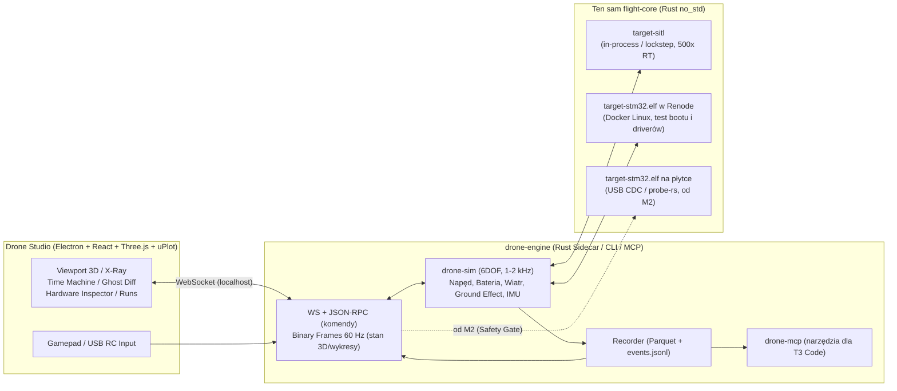

# Blueprint techniczny M0 + M1: „Drone Studio” (Mikro-Quad na dłoń)

> [!NOTE]
> Dokument przekłada zatwierdzone decyzje z [drone-platform-analysis.md](./drone-platform-analysis.md) na konkretny projekt techniczny gotowy do implementacji w **M0 (Fundamenty)** i **M1 (First Hover in Studio + Renode Smoke)**.

---

## 1. Referencyjny dron #1: `palm_x4_2in` (mikro-quad „na dłoń”)

Zaczynamy od jednego, realistycznego cyfrowego bliźniaka, który można później w 100% wydrukować i złożyć z gotowych podzespołów za ok. 500–750 zł:

| Parametr                        | Wartość docelowa (`palm_x4_2in`)                                                                                     | Uzasadnienie                                                                                                                                                                                         |
| ------------------------------- | -------------------------------------------------------------------------------------------------------------------- | ---------------------------------------------------------------------------------------------------------------------------------------------------------------------------------------------------- |
| **Rozstaw osi (przekątna)**     | **95–100 mm** (mieści się na dłoni)                                                                                  | Idealna skala pod druk 3D (sztywna rama, czas druku ~30 min, opcjonalne osłony śmigieł do lotu w pokoju)                                                                                             |
| **Masa startowa (AUW)**         | **~105–135 g** (z baterią)                                                                                           | Głęboko poniżej 250 g (EASA/ULC A1), bezpieczny w testach indoor                                                                                                                                     |
| **Śmigła / Silniki**            | **2" (51 mm) 3-łopatowe**, silniki **1103 / 1202.5 (~8000–11000 KV)**                                                | Świetny stosunek ciągu do masy (TWR ~3.5–4.5:1 → zapas na zwinność i późniejsze czujniki)                                                                                                            |
| **Bateria**                     | **2S LiPo/LiHV 550–650 mAh** (7.4–8.7 V)                                                                             | Bezpieczniejsza i lżejsza niż 4S–6S, wystarcza na 5–8 min lotu                                                                                                                                       |
| **Kontroler lotu (gotowy AIO)** | **STM32H743 AIO** _(np. JHEMCU/Flywoo H743 25.5×25.5)_ **lub STM32F405 AIO** _(np. BetaFPV/SpeedyBee F405 2-3S AIO)_ | Rekomendacja na start jako profil #1: **STM32H743** (ogromny zapas RAM/CPU na przyszłą autonomię + oficjalny profil w Renode) i równoległy profil **STM32F405** (najbardziej dostępny w tanich AIO). |
| **Czujniki bazowe**             | **IMU: ICM-42688-P** (SPI, 2–4 kHz), **Baro: BMP390 / DPS310** (I2C)                                                 | Złoty standard nowoczesnych FC, świetne parametry szumowe, proste sterowniki w Rust                                                                                                                  |
| **Czujniki fazy 2 (autonomia)** | **ToF VL53L1X** (wysokość w pokoju) + **Optical Flow** / mikro-GPS                                                   | Już przewidziane w schemacie manifestu, nieaktywne w M1                                                                                                                                              |
| **Sterowanie ręczne (M1+)**     | Wirtualny pad / joystick USB HID (Xbox/PS/ELRS po USB) w M1; realne radio **ELRS 2.4 GHz (CRSF po UART)** w M2       | Od M1 możesz sam polatać dronem w Drone Studio na padzie lub aparaturze podpiętej po USB!                                                                                                            |

---

## 2. Architektura systemu i komunikacja procesów

Całość spina jeden natywny daemon w Ruście (`drone-engine`), który uruchamia się albo jako **sidecar Electrona**, albo bezpośrednio z terminala/agentów AI:



### Dlaczego podział `Electron UI` ↔ `drone-engine (Rust)` jest optymalny?

1. **Zero logiki fizycznej i sprzętowej w Electronie:** Node/Electron robi tylko okno, menu, auto-update i uruchamia binarkę `drone-engine` ze swojego katalogu `resources/`.
2. **Parytet 1:1 człowiek ↔ agent AI:** UI i agent AI korzystają z **tej samej warstwy komend i tego samego formatu zapisu lotu (`runs/<id>/`)**.
3. **Przyszłe Web Demo:** ten sam frontend React + Three.js może się połączyć albo z `drone-engine` przez WebSocket, albo (w M5) z `drone-sim` skompilowanym do **WebAssembly** w przeglądarce!

---

## 3. Struktura monorepo (gotowa pod agentów AI)

```
drone-studio/
├── AGENTS.md                        # Instrukcje dla agentów AI, konwencje, zasady Safety Gate
├── Cargo.toml                       # Rust workspace (host crates)
├── package.json                     # Workspace Node/pnpm dla Electron + UI
├── hardware/                        # JEDNO ŹRÓDŁO PRAWDY (YAML + JSON Schema)
│   ├── schemas/                     # Walidacja schematów manifestów
│   ├── catalog/
│   │   ├── mcus/stm32h743vi.yaml
│   │   ├── sensors/icm42688p.yaml
│   │   ├── sensors/bmp390.yaml
│   │   ├── motors/1202_5_8000kv.yaml
│   │   ├── props/gemfan_2023_3blade.yaml
│   │   └── batteries/2s_550mah_lihv.yaml
│   ├── boards/
│   │   └── ref_h743_aio.yaml        # MCU, pinout, SPI/I2C/UART/TIM, układ 2D padów do UI
│   ├── airframes/
│   │   └── palm_x4_2in/
│   │       ├── airframe.yaml        # Geometria 95 mm, komponenty, limity, PSD drgań
│   │       ├── model.glb            # Model 3D (w M0 proceduralny/prosty, od M3 z CAD)
│   │       └── mass_properties.json # Masa, CoM, tensor bezwładności Ixx, Iyy, Izz
│   └── scenarios/
│       ├── 01_hover_calm.yaml
│       ├── 02_step_roll_pitch.yaml
│       ├── 03_wind_gust_6ms.yaml
│       ├── 04_motor_loss_recovery.yaml
│       └── 05_battery_sag_landing.yaml
├── crates/
│   ├── drone-schema/                # Parser YAML, walidator, `codegen` (firmware, sim, renode, UI)
│   ├── drone-protocol/              # `no_std` postcard + COBS: Telemetria, Komendy, Lockstep
│   ├── drone-sim/                   # Headless fizyka 6DOF + środowisko + modele czujników
│   ├── drone-telemetry/             # Zapis/odczyt Parquet + silnik zapytań/anomalii/diffów
│   ├── drone-engine/                # Daemon WS/JSON-RPC + menedżer uruchomień (sidecar Electrona)
│   ├── drone-cli/                   # CLI (`drone codegen|sim|analyze|diff|emu|studio`)
│   └── drone-mcp/                   # Lokalny serwer MCP (stdio) dla T3 Code / agentów AI
├── firmware/                        # Osobny workspace pod embedded (no_std + cross-compile)
│   ├── flight-core/                 # Czyste algorytmy: AHRS/EKF, PID, Mixer, Arming/Failsafe
│   ├── flight-hal/                  # Traity sprzętowe: Imu, Baro, MotorOutput, RadioInput, Clock
│   ├── target-sitl/                 # Implementacja flight-hal dla lockstepu w drone-sim
│   └── target-stm32h7/              # Prawdziwy firmware `embassy-rs` (kompilowany na ARM `.elf`)
├── emu/                             # Tor Renode (od M1!)
│   ├── Dockerfile                   # Lekki obraz Linux + Renode (działa identycznie na macOS/CI)
│   ├── sensors/Icm42688p.cs         # Minimalny model SPI czujnika IMU w C# dla Renode
│   ├── generated/ref_h743_aio.repl  # Generowane przez `drone codegen`
│   └── tests/boot_and_loop.robot    # Automatyczny test startu firmware'u i pętli sterowania
└── studio/                          # Aplikacja desktopowa Electron
    ├── electron/                    # Main process, preload, lifecycle sidecara `drone-engine`
    └── renderer/                    # React + TypeScript + Tailwind + React Three Fiber + uPlot
        ├── components/viewport3d/   # 3D Digital Twin, X-Ray, wektory ciągu, Ghost Target/Diff
        ├── components/timeline/     # Flight Time Machine (scrubber, event markers, playback)
        ├── components/telemetry/    # Wykresy 60 FPS (uPlot), FFT, metryki lotu
        ├── components/inspector/    # Widok płytki 2D (SVG), piny, czujniki, swap komponentów
        └── components/runs/         # Live Lab Feed (wyniki agentów AI, PASS/FAIL, A/B Diff)
```

---

## 4. Kontrakty kluczowe (kręgosłup techniczny)

### A. Protokół Lockstep (`drone-sim` ↔ `flight-core` / SITL / Renode)

W każdym kroku symulacji (np. fizyka **2 kHz** = `dt = 0.5 ms`, pętla kontrolera **1 kHz** = `1.0 ms`):

1. Symulator liczy fizykę 6DOF, napęd, baterię, wiatr, _ground effect_ i generuje zaszumione odczyty czujników (`ImuSample`, `BaroSample`, `BatteryAdc`, `RcInput`) z deterministycznego PRNG (`seed`).
2. Wysyła strukturę `SimStepInput` do backendu firmware'u i rozkazuje przesunąć czas o `dt`.
3. Firmware (`flight-core`) wykonuje krok estymacji, regulatorów i miksera, zwracając `ActuatorOutput` (`motor_cmd[4]`, `arm_state`, `telemetry_frame`, `debug_logs`).
4. Symulator aplikuje komendy do modelu silników i zapisuje klatkę do `telemetry.parquet`.

### B. Format zapisu lotu (`runs/<timestamp>_<slug>/`)

Każdy lot (ręczny, automatyczny, albo agenta AI) tworzy niezmienny katalog:

- `meta.json` — git SHA, użyty `airframe.yaml` (hash), `scenario.yaml`, `seed`, wynik asercji (`PASS/FAIL`), podsumowanie metryk.
- `telemetry.parquet` — wszystkie kanały (stan prawdy 6DOF + odczyty czujników + estymacja firmware'u + setpointy + komendy silników + prąd/napięcie baterii). Błyskawiczny odczyt w UI i zapytania kolumnowe dla agentów.
- `events.jsonl` — zdarzenia z timestampem (`ARM`, `GUST_START`, `SATURATION`, `ASSERT_FAIL`, logi firmware'u).

### C. Narzędzia MCP dla agentów AI (`drone-mcp`)

Agent pracujący w T3 Code dostaje gotowy, wysokopoziomowy zestaw narzędzi:

- `sim_run(scenario, airframe?, overrides?, seed?)` → uruchamia lot, zwraca `run_id` i raport metryk/asercji.
- `sim_suite(tags?)` → odpala pakiet regresji równolegle na wszystkich rdzeniach CPU.
- `run_anomalies(run_id)` → wykrywa oscylacje, saturacje silników, spadki napięcia, przekroczenia błędów.
- `run_slice(run_id, t_start, t_end, signals, max_rows)` → wyciąga okno czasowe do analizy.
- `run_diff(baseline_id, candidate_id)` → porównuje metryki dwóch lotów (idealne do strojenia PID/filtrów).
- `emu_smoke_test(board?)` → kompiluje `.elf` na ARM i odpala test weryfikacyjny w Renode.
- `studio_focus(run_id, timestamp?)` → jeśli Drone Studio jest otwarte, natychmiast ładuje ten lot i ustawia suwak czasu na wskazanej sekundzie!

---

## 5. Projekt UX dla Drone Studio v0.1 (M1 — już wygląda jak wizytówka)

Aby już w M1 aplikacja robiła piorunujące wrażenie estetyką i ergonomią:

- **Estetyka wizualna:** ciemny, precyzyjny styl „aerospace / hardware lab” (głęboki grafit `#0B0E14`, ostra typografia `Inter` + `JetBrains Mono` dla liczb o stałej szerokości, czytelne kodowanie kolorami trybów: **Cyjan = SIM**, **Bursztyn = EMU**, **Szmaragd/Czerwień = REAL**).
- **Główny układ ekranu (4 strefy):**
  1. **Górny pasek kontekstu:** przełącznik `SIM / EMU / REAL`, wybór drona (`palm_x4_2in`), wybór scenariusza, przycisk `PLAY / PAUSE / RESET (R)`, przełącznik prędkości (`0.1×`, `0.5×`, `1×`), oraz przycisk **`Showcase Mode`** (ukrywa panele techniczne, zostawia kinowy widok 3D + HUD + sterowanie padem).
  2. **Centrum — Interaktywny 3D Viewport (Three.js / R3F):**
     - Przełącznik trybu **`Studio`** (czysty model 3D, oświetlenie studyjne) vs **`X-Ray`** (półprzezroczysta rama, podświetlone FC/IMU/bateria, wektory ciągu 3D nad śmigłami, marker środka masy, wektor wiatru, półprzezroczysty **Ghost Target** zadanej orientacji).
     - Możliwość włączenia nakładki **`Ghost Diff`** — drugi półprzezroczysty dron z innego lotu lecący obok w tym samym czasie.
     - Obsługa pada / aparatury RC po USB (HTML5 Gamepad API → `drone-engine`) do ręcznego latania w czasie rzeczywistym!
  3. **Prawy panel (zakładki):**
     - **Inspector:** interaktywny schemat 2D płytki wygenerowany z `ref_h743_aio.yaml` (piny, magistrale SPI/I2C/TIM, status czujników) + szybka podmiana baterii/śmigieł/silników z `catalog/` (na żywo przelicza masę, TWR i zapisuje diff w YAML).
     - **Telemetry:** 3–4 zsynchronizowane wykresy `uPlot` 60 FPS (Orientacja vs Setpoint, Wyjścia silników 1–4, Napięcie/Prąd baterii, FFT wibracji IMU).
     - **Runs (AI Feed):** lista lotów z `runs/` z badge'ami `PASS/FAIL`, kliknięcie ładuje lot do Time Machine, przycisk `Compare (Ghost Diff)` nakłada na bieżący lot.
  4. **Dolny pasek — Flight Time Machine:** oś czasu z markerami zdarzeń, płynne przesuwanie kursora cofające 3D + wykresy + logi konsoli w idealnej synchronizacji.

---

## 6. Plan wdrożenia krok po kroku (M0 + M1) i kryteria odbioru

### Etap M0 — Fundamenty, Manifest i Szkielet Repo (~1 tydzień)

1. Inicjalizacja monorepo (`Cargo.toml` workspace + `firmware/` workspace + `studio/` Electron/Vite/React/TS + `AGENTS.md`).
2. Implementacja `drone-schema`: JSON Schema + parser YAML dla `catalog/`, `boards/`, `airframes/`, `scenarios/` oraz pełny zestaw plików dla `palm_x4_2in`.
3. Implementacja `drone codegen`: generuje konfigurację firmware'u (Rust), konfigurację symulatora, plik `.repl` dla Renode oraz `board_layout.json` dla Electron Studio.
4. Implementacja `drone-protocol` (`no_std`, `postcard` + `COBS`).

- **Kryterium odbioru M0:** `drone validate && drone codegen` przechodzi na zielono, generuje wszystkie 4 artefakty z jednego YAML, a `cargo check` buduje zarówno host, jak i cel `thumbv7em-none-eabihf`.

### Etap M1 — „First Hover in Studio” + Tor Renode (~3–4 tygodnie)

1. **Rdzeń fizyki (`drone-sim`):** 6DOF (kwaterniony, RK4 @ 2 kHz), model silnika/śmigła (ciąg, moment, stała czasowa, prąd), bateria Thevenina (voltage sag), środowisko (wiatr + Dryden + _ground effect_ przy podłodze), modele czujników (IMU ICM-42688-P z szumem/biasem/drganiami, baro BMP390).
2. **Firmware (`flight-core` + `target-sitl`):** estymacja orientacji (Madgwick/Mahony), kaskada PID (kąt → prędkość kątowa), mikser X4, maszyna stanów (DISARMED / ARMED / FAILSAFE), obsługa ręcznego sterowania i trybu utrzymania wysokości/zawisu.
3. **Tor Renode (od M1!):** `firmware/target-stm32h7` na `embassy-rs` + `emu/Dockerfile` (Renode) + minimalny model `Icm42688p.cs` + test `drone emu smoke` weryfikujący boot `.elf`, odczyt `WHO_AM_I` i 100 kroków pętli sterowania na emulowanym STM32H7.
4. **Telemetria, CLI i MCP (`drone-telemetry`, `drone-cli`, `drone-mcp`):** zapis Parquet, 5 bazowych scenariuszy regresji, narzędzia `anomalies` / `slice` / `diff`, pełny serwer MCP.
5. **Drone Studio v0.1 (`studio/` Electron):** sidecar `drone-engine`, 3D Viewport (Studio + X-Ray + wektory ciągu + Ghost Diff), Flight Time Machine, wykresy uPlot, Hardware Inspector (2D płytka + podgląd komponentów), panel Runs, obsługa pada USB i tryb `Showcase Mode`.

- **Kryterium odbioru M1 („wow moment”):**
  - Odpalasz aplikację Electron na macOS, widzisz mikro-drona `palm_x4_2in` w 3D, przełączasz na **X-Ray**, wciskasz Play lub bierzesz pada i **latasz nim na żywo**;
  - Możesz cofnąć lot na **Flight Time Machine**, włączyć **Ghost Diff** między dwoma lotami i kliknąć płytkę FC w **Hardware Inspectorze**;
  - Agent AI przez MCP uruchamia `sim_suite` (5 scenariuszy w <2 s) oraz `emu_smoke_test` (prawdziwy `.elf` w Renode) i wszystkie przechodzą na zielono.
